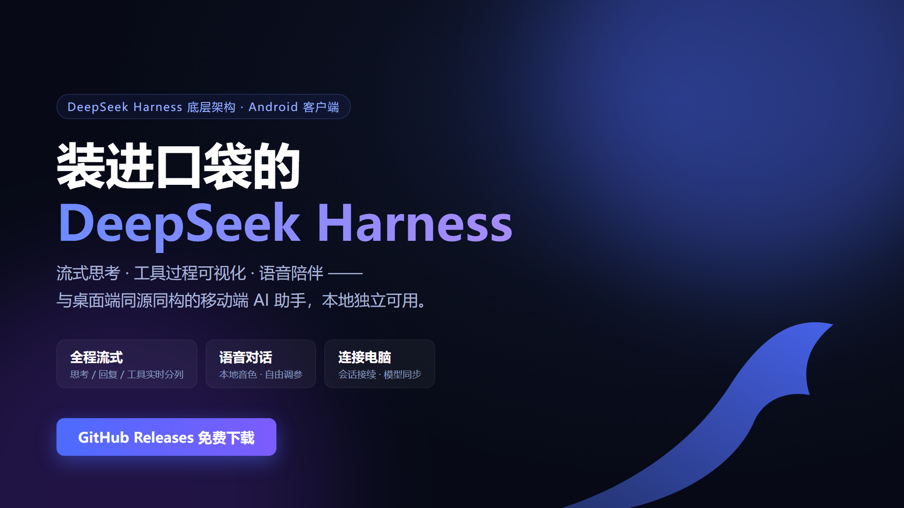
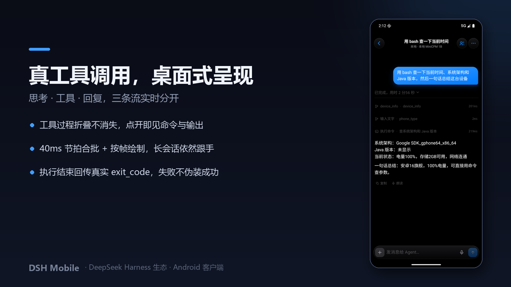
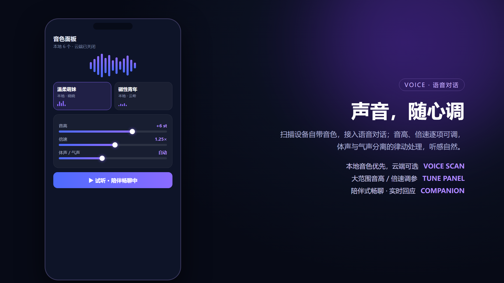
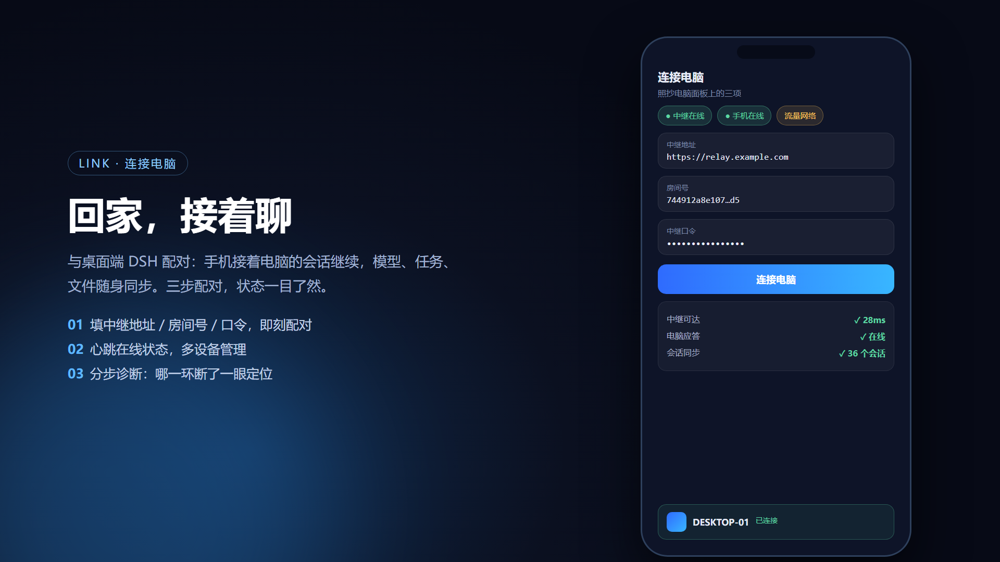

# DSH Mobile

**装在口袋里的 DeepSeek Harness** —— Android 端 AI 助手客户端。本地独立可用，也能随时连上电脑接着聊。

> 本仓库仅发布安装包与说明，不包含源代码。



**▶ [观看宣传视频](assets/promo.mp4)**（约 26 秒，含对话 / 语音 / 连接电脑三大场景）

## 来源与架构

DSH Mobile 是 **DeepSeek Harness（DSH）** 生态的 Android 客户端，与桌面端 DSH 同源同构：

- **同一套底层**：会话引擎、流式协议、工具调用、任务与文件体系与桌面端一一对应；
- **同一套交互范式**：流式思考、工具过程可视化（折叠但不消失的桌面式工具行）、鲸尾思考动效、语音律动，在手机上逐一还原；
- **不是移植，是重建**：针对移动端重新设计导航、输入、通知与语音交互，是一个完整独立的 AI 应用。

本地独立模式开箱即用（会话数据只存手机，无账号、无服务器依赖）；与电脑配对后，它又成为桌面 DSH 的随身延伸。

## 功能总览

### 对话引擎
- **全程流式输出**：思考过程、正文回复、工具调用三条流实时分开呈现；40ms 固定节拍合批 + 按帧绘制，长会话下依然跟手
- **多会话管理**：创建、搜索、置顶、删除，会话数据完全本地；发送队列、插话、后台任务
- **任意模型接入**：OpenAI 兼容 API（含本地 llama.cpp / Ollama），自定义地址 / 密钥 / 模型，多模型热切换
- **图片发送**：对话中直接发图，配合多模态模型使用
- **掉线自愈**：渲染进程被系统回收后，页面自动重新接回仍在运行的回复，内容不再凭空消失

### 手机内造 App（rc.111 起）
在手机上**从零生成一个能装的 Android 应用**，全程不需要电脑：

- `app_new`：生成完整工程（清单 / 文案 / 五档图标 / 多页 Activity），图标由自研 PNG 编码器按主题色现画，零素材
- `app_build`：手机内完整打包（aapt2 → ecj → d8 → apksigner），构建常驻守护让重复构建只要 **2 秒级**
- `app_install`：交给系统安装器并回传终态；产物用**本机专属 RSA-2048 密钥**签名（首次构建自动生成，支持后续覆盖升级），不再是公共 debug 密钥

### 终端与代码执行（rc.112 起）
- **workspace 后端**：完整 rootfs 环境，`java / python3 / gcc / node / git` 直接可用，路径语义与工具调用一致
- **device 后端**：安卓宿主 shell，可访问 /sdcard、`pm`、`am` 等系统能力
- 命令结束以 shell 结束标记判定：真实 `exit_code`、不吞慢命令、失败不再伪装成功

### 智能体协作
- **团队模式**：Lead 拆解任务、队友并行执行、任务板可视，收件箱交互与桌面 agent-team 同构
- **插件市场查询**（`plugin_market`）：与桌面端同一套 format 1 协议，检索插件、版本与安装 spec



### 语音
- **朗读与陪伴式畅聊**：AI 以语音实时回应，边聊边听；语音问 → 语音答（对讲机式），内容不适合口述时自动退回文字
- **两档音色**：**经典女**（系统 TTS 自带女声，原声不变调，默认档）· **经典男**（唯一内置神经网络音色，int8 量化单包 33MB）
- **语音条直发**：按住输入框麦克风直接录一条语音发出，气泡点击回放；agent 收到的是识别后的文字，照常理解与执行；忙碌时自动排队，绝不无声吞掉
- **音色调参面板**：倍速、音量、明亮度、句间停顿独立可调
- **语音律动**：一阶低通拆分「体声 / 气声」，近讲感与呼吸感自然



### 任务与文件
- **后台任务**：发起后可离开对话页，完成推送通知
- **文件系统**：按应用组织的附件与产出浏览
- **运行通知中心**：连接、任务、运行状态集中管理

### 连接电脑（可选扩展）
- 与桌面端 DSH 配对：手机接续电脑会话，上下文无缝衔接
- 切换电脑端模型与思考强度，查看电脑端文件与任务
- 中继三步配对（地址 / 房间号 / 口令），多设备管理、心跳在线状态、分步连接诊断



## 下载安装

前往 [Releases](../../releases) 下载**按 CPU 架构分包**的安装包（rc.111 起，每包只带本机架构的运行环境，比旧通用包省约 110MB）：

| 包 | 适合 |
|---|---|
| `DSH-Mobile-x.x.x-**arm64-v8a**-release.apk` | 手机（几乎所有真机） |
| `DSH-Mobile-x.x.x-**x86_64**-release.apk` | 模拟器 / x86 平板 |

1. 允许「安装未知来源应用」后安装；
2. 打开 App，在设置中配置模型 API 与密钥即可开始对话（支持任意 OpenAI 兼容端点与本地模型）；
3. （可选）设置 → 连接电脑，填桌面端面板三项完成配对。

每个版本的详细变更见 [CHANGELOG.md](CHANGELOG.md)。

## 连接电脑：Mobile Link 桌面插件

「连接电脑」功能由配套的 **DSH 桌面插件 `dsh-mobile-link`** 提供（本仓库 [`desktop-plugin/`](desktop-plugin/) 目录，含完整安装说明）：

- 桌面面板显示 **中继地址 / 房间号 / 口令** 三项，手机端填入即配对，每项带一键复制
- 手机可浏览并**续接电脑上的真实会话**，消息进入桌面端 agent 收件箱
- 内置零依赖中继（`relay/server.mjs`），也可自托管到 VPS / Docker，两端都只做出站连接，无需公网 IP

安装（DSH CLI，支持 GitHub 直装）：

```bash
dsh plugin --profile <profile名> add "github:xiaobaga281/dsh-mobile#path:desktop-plugin"
```

或按 [`desktop-plugin/README.md`](desktop-plugin/README.md) 的手动方式放入 `%USERPROFILE%\.dsh\plugins\`。

## 质量透明

工具能力按「覆盖 / 质量 / 准确 / 速度 / 易用 / 鲁棒」六维自评（1–10），每条分数都要求对应代码位置或实测数据，逐域取证见仓库内文档：

- [docs/score-v4-v5.md](docs/score-v4-v5.md) —— rc.111 → rc.112 九域六维进步表（全局 7.4 → 7.8）
- [docs/fixes-rc113.md](docs/fixes-rc113.md) —— rc.113 五项修复清单（附实测）
- [docs/fixes-rc114-115.md](docs/fixes-rc114-115.md) —— rc.114/rc.115 修复清单（PaX W^X 根治 + 滚动定位 + 授权档位）

## 系统要求

- Android 8.0（API 26）及以上（arm64 真机 / x86_64 模拟器）
- 独立使用：任一 OpenAI 兼容模型的 API 地址与密钥（或本地 llama.cpp 端点）
- 手机内造 App：完整版安装包（内含 Linux 运行环境与编译工具链）
- 连接电脑：桌面端 DSH + Mobile Link 插件（可选）

## 隐私与安全

- 无遥测、无统计 SDK、不收集任何数据
- 会话数据默认只存本机
- 本仓库不提供源代码，安装包按「现状」提供

## 版本

当前发布版本：**0.2.1-rc.115**，见 [Releases](../../releases)；逐版本变更见 [CHANGELOG.md](CHANGELOG.md)。

近期亮点（rc.111 – rc.115）：
- **手机内造 App 全链路**：脚手架 → 打包（2 秒级热构建）→ 专属签名 → 安装
- **终端双后端**：rootfs 完整环境（java/python3/gcc/node/git）+ 安卓宿主 shell
- **PaX/W^X 内核兼容根治**：签名改宿主内自签（rc.113）+ JVM 启动器 paxctl 豁免补丁（rc.115），grsecurity 加固内核上 app_build 不再反复失败
- **ABI 分包**：完整版安装包 346MB → 237MB
- **流式与交互**：合批统一 40ms 节拍、渲染进程回收后自动接回、语音消息排队不丢失、发送/重进会话精准贴底、授权「始终允许」真实生效

## 许可

仅供个人使用，未经授权请勿二次分发。
